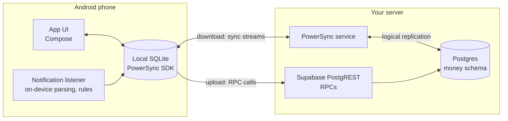

**English** | [Русский](README.ru.md)

# 4Money — self-hosted fork

A local-first Android expense tracker that keeps your data on your own server and books card
payments from bank notifications. You run Supabase (Postgres) and a PowerSync service; the app keeps
a full copy of your data on the phone, works offline and syncs when it can. Bank push notifications
are parsed on the phone, matched against your payee rules and either recorded as expenses or put
into an Inbox to sort with a swipe. Your 1Money history can be imported.

This is a fork of [4Money](https://github.com/Radiokot/4money) by Oleg Koretsky. The data model,
sync, multi-currency handling and much of the code are his; this fork adds a documented backend,
notification auto-booking, a redesigned UI and the features listed below.

## Why this fork

- **Self-hosted.** The Postgres schema, RPCs and PowerSync config live in this repo
  (`supabase/migrations`, `deploy/powersync`). Everything goes to your server and nowhere else.
- **Local-first sync.** A local SQLite database through the PowerSync SDK; the app works fully
  offline, and changes upload when the server is reachable (on app open, and every 30 minutes in
  the background).
- **Bank notifications become transactions, on the device.** A notification listener reads payment
  notifications from the apps you choose, extracts amount, currency, payee and card digits, and
  creates the expense or income with no network call. SEB Latvia is a built-in preset; any other app
  can be taught in a wizard: pick a sample notification, tap which words are the amount, currency,
  payee and card, test the result against recent notifications.
- **Payee rules.** Exact or "contains" payee matching (one rule covers `COFFEE HOUSE CENTRE`
  and `COFFEE HOUSE RIVERSIDE`), amount ranges per payee (under 10 € → Food, over 35 € → Car), and an
  "Ask me" target. Rules are learned while you sort.
- **Inbox.** Unmatched payments wait in an Inbox tab. Sort them as swipe cards (right = accept the
  suggested category, left = skip, up = pick another), or answer straight from the "Payments to sort"
  notification with up to three category buttons, without opening the app.
- **1Money import.** `tools/onemoney-import` reads the 1Money backup file and produces SQL for the
  schema: accounts, categories, subcategories and transaction history.
- **Privacy mode.** One tap hides absolute amounts (`•••`) and shows the rest as percentages, so
  screenshots can be shared.
- **Home screen widget.** Income / expense quick entry and the number of payments waiting in the Inbox.
- **Themes and languages.** Paper (light), Midnight, Ember and Aurora (dark), or follow the system.
  English and Russian, switchable in the app.

## Comparison

To the best of our knowledge, October 2026. "Not yet" means missing in this fork and possibly
added later. Features that only this fork has are listed in "Why this fork" above.

| | 4Money fork | 1Money | Upstream 4Money |
|---|---|---|---|
| Open source | Yes, GPL-3.0 | No | Yes, GPL-3.0 |
| Where the data lives | Your server, full copy on the phone | 1Money's cloud | Supabase + PowerSync, full copy on the phone |
| Self-hosting docs and server schema | Yes | No | Not published |
| Works offline | Yes | Yes | Yes |
| Multi-currency, currency exchange | Yes (inherited) | Yes | Yes |
| Booking from bank notifications | Yes, parsed on the device | No | No |
| Payee rules (exact, contains, amount ranges) | Yes | No | No |
| Inbox with swipe sorting | Yes | No | No |
| Import from 1Money | Yes (backup file → SQL) | — | A test script for CSV exports |
| Recurring / scheduled transactions | Not yet | Yes | No |
| Budgets | Not yet | Yes | No |
| Search | Not yet | Yes | No |
| Projected balance | Not yet | Yes | No |
| iOS | Not yet | Yes | No |

## Architecture

- Reads come from the local database only. PowerSync streams changes from Postgres (logical
  replication, a dedicated publication on the `money` schema) into the phone's SQLite.
- Writes go to the local database first and are uploaded by the PowerSync connector through
  Supabase PostgREST RPCs (`atomic_crud`, `transfer`, `transfer_edit`, `transfer_revert`).
  Balances are recomputed on the server when a transfer is uploaded; `transfer` is idempotent by id.
- The notification listener is bound by the system only when a notification is posted: no
  foreground service, no polling, no network access of its own.
- The server can sit behind a VPN such as Tailscale (the app allows cleartext HTTP for the hosts
  you list in `cleartextHosts`) or behind an HTTPS reverse proxy.

## Quick start (self-hosting)

You need a Supabase instance (self-hosted or Supabase Cloud) with logical replication, Docker for
the PowerSync service, and a way for the phone to reach both.

1. Apply the SQL migrations from `supabase/migrations` in order and expose the `money` schema in
   PostgREST.
2. Start PowerSync from `deploy/powersync` with Postgres bucket storage and your Supabase JWT secret.
3. Create the app user in Supabase Auth.
4. Fill `app/local.properties` with your URLs, keys and credential, build and install the app.

Step-by-step guide: [docs/self-hosting.md](docs/self-hosting.md).
Moving from 1Money: [docs/importing-from-1money.md](docs/importing-from-1money.md).

## Building from source

Android Studio or the Gradle wrapper with JDK 21 and the Android SDK; the app targets Android 8.0
(API 26) and later. Build, tests, lint and the project layout:
[docs/DEVELOPMENT.md](docs/DEVELOPMENT.md). Contributions: [CONTRIBUTING.md](CONTRIBUTING.md).

## Privacy and security model

**Stays on the phone:**
- Notifications from apps that are not configured sources. The listener checks the package name
  and returns; a cheap money-looking check (an amount next to a currency) feeds only the buffer below.
- The recent-notification buffer used by the setup wizard: the last 50 money-looking notifications
  from the last 7 days, in a private no-backup file. Never synced, never logged; cleared when a source
  is set up, on sign-out and when notification access is revoked.
- Device settings: which presets are on, the auto-booking behaviour switches, theme, language,
  privacy mode, passcode.

**Synced to your server** (and only there), per user with row-level security:
- Accounts, categories, transactions, payee rules.
- Inbox items. Every notification from a configured source becomes an inbox item with the parsed
  amount, currency, payee and the card's last 4 digits, and `raw_text`: the full title and text of
  that notification, also when it could not be parsed.
- Notification templates taught in the wizard, including `sample_text`: the full title and text of
  the sample notification you picked.

**Not there at all:** no analytics, crash reporting or advertising SDKs, no third-party services.
The app talks only to the Supabase and PowerSync URLs you build it with.

Logs go to logcat and to daily files in the phone's public `Documents` folder (release builds log
`INFO` and above, debug builds log more verbosely). Notification processing logs the outcome and the source package, not texts,
amounts, payees or card digits.

## Status

A personal project, used daily, tested by a single user. Not published in any app
store; build it yourself. Known gaps:
- Daily currency prices come from the `update-pairs` edge function, which this fork does not deploy,
  so totals across currencies need it set up first.
- The phrase (Ed25519) sign-in from upstream is in the code, but its edge functions are not
  deployed; the fork signs in with an email and password from `local.properties`.

## Screenshots

<!-- TODO(owner): add screenshots of the fork (no real financial data). Do not reuse upstream's
     fastlane screenshots here, they show the old UI. -->
Screenshots are coming.

## For developers

Points of interest, mostly from upstream's design:

- **PowerSync with Supabase:** `AtomicCrudSupabaseConnector` (uploads a local transaction as
  RPC calls), `PowerSyncTransferHistoryRepository`, `PowerSyncTransferFundsUseCase`,
  `BackgroundPowerSyncWorker`.
- **Custom Supabase auth by Ed25519 signature:** `SignInWithPhraseUseCase` and the
  `signature-auth-challenge` / `signature-auth` edge functions.
- **User-ordered collections:** positions of accounts and categories are assigned with a
  Stern-Brocot tree, so a drag changes one row: `SternBrocotTreeSearch`, `MovableAccountList`,
  `PowerSyncMoveAccountUseCase`.
- **Counter-like amount animation:** a `BigInteger` can't go into an `Animatable`, so an integer
  0..1000 is animated and used as a multiplier: `animateAmountValueAsState`.
  
- **Bottom sheets as navigation destinations** without Material: `BottomSheetNavigation`,
  `AccountActionSheetNavigation`.
- **150,000 daily currency prices** kept out of sync limits in a separate local database, updated
  by RPC: `LocalCurrencyPriceRepository`, `DailyPrices.sq`.
- **Logging:** kotlin-logging over SLF4J with logback-android (Kermit from libraries is routed there
  too): `logback.xml`, `MoneyApp.initLogging()`.

Added by the fork:

- **Notification parsing:** `BankNotificationListenerService`, `NotificationSourceRegistry`
  (preset first, then the user's templates), `TemplateBuilder` / `SampleTokenizer` (sample text →
  regex), `BankNotificationDedupHash`.
- **Rules:** `PayeeNormalizer`, `PayeeRuleMatcher` (narrowest amount range wins, exact before
  contains), `PayeeRulePatternSuggester`.
- **Widget:** `QuickEntryWidget` (Glance), updated by events, no periodic updates.

Tech stack: Kotlin, Jetpack Compose with Compose Unstyled (no Material), coroutines and Flow, Koin,
Supabase (PostgREST, functions), PowerSync, SQLDelight, Glance.

Design history: the spec in
[docs/superpowers/specs/2026-10-01-self-hosted-4money-design.md](docs/superpowers/specs/2026-10-01-self-hosted-4money-design.md),
the feature plans in [docs/superpowers/plans](docs/superpowers/plans), and the changelog in
[docs/features.md](docs/features.md).

## License and credits

GPL-3.0, see [COPYING.txt](COPYING.txt).

- [4Money](https://github.com/Radiokot/4money) by Oleg Koretsky, the app this fork is built on.
- Line icons: [Tabler Icons](https://github.com/tabler/tabler-icons), MIT (see `tools/icons/README.md`).
- Font: [Onest](https://github.com/googlefonts/onest), SIL Open Font License 1.1
  (`app/src/main/assets/licenses/onest-OFL.txt`).
- 1Money is a trademark of its owners. This project is not affiliated with it and contains no
  1Money assets.
