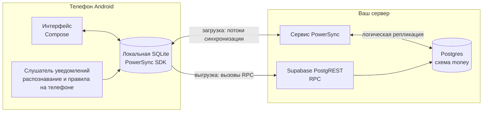

[English](README.md) | **Русский**

# 4Money — self-hosted форк

Local-first трекер расходов для Android: данные лежат на вашем сервере, а оплаты картой
записываются сами по уведомлениям банка. На сервере работают Supabase (Postgres) и PowerSync,
в телефоне хранится полная копия данных, приложение работает без сети и синхронизируется, как
только сервер доступен. Push-уведомления банка распознаются прямо на телефоне, сверяются с вашими
правилами по получателям и либо сразу становятся расходом, либо попадают во «Входящие», где их
можно разобрать свайпами. Историю из 1Money можно импортировать.

Это форк [4Money](https://github.com/Radiokot/4money) Олега Корецкого. Модель данных,
синхронизация, работа с валютами и значительная часть кода — его. Форк добавляет описанный и
воспроизводимый бэкенд, автозапись по уведомлениям, новый интерфейс и функции из списка ниже.

## Зачем этот форк

- **Свой сервер.** Схема Postgres, RPC и конфиг PowerSync лежат в репозитории
  (`supabase/migrations`, `deploy/powersync`). Данные уходят только на ваш сервер.
- **Local-first синхронизация.** Локальная SQLite через PowerSync SDK: без сети приложение
  работает полностью, изменения уходят на сервер, когда он доступен (при открытии приложения и
  раз в 30 минут в фоне).
- **Уведомления банка превращаются в операции прямо на телефоне.** Слушатель уведомлений читает
  уведомления о платежах от выбранных приложений, достаёт сумму, валюту, получателя и цифры карты
  и создаёт расход или доход без единого сетевого запроса. SEB Latvia есть как встроенный пресет,
  любое другое приложение можно «обучить» в мастере: выбираете пример уведомления, отмечаете,
  какие слова — сумма, валюта, получатель и карта, и проверяете шаблон на последних уведомлениях.
- **Правила по получателям.** Точное совпадение или «содержит» (одно правило ловит и
  `COFFEE HOUSE CENTRE`, и `COFFEE HOUSE RIVERSIDE`), диапазоны сумм для одного получателя
  (до 10 € → Еда, больше 35 € → Машина) и вариант «Спросить». Правила запоминаются по ходу
  разбора.
- **Входящие.** Платежи, для которых нет правила, ждут во вкладке «Входящие». Их можно разобрать карточками
  (вправо — принять предложенную категорию, влево — пропустить, вверх — выбрать другую) или
  ответить прямо из уведомления «Платежи к разбору»: до трёх кнопок с категориями, приложение
  открывать не нужно.
- **Импорт из 1Money.** `tools/onemoney-import` читает файл резервной копии 1Money и выдаёт SQL
  для схемы: счета, категории, подкатегории и историю операций.
- **Режим приватности.** Одно нажатие прячет абсолютные суммы (`•••`), остальное показывается в
  процентах — скриншот можно спокойно отправить.
- **Виджет на рабочий стол.** Быстрый ввод дохода и расхода и счётчик платежей во «Входящих».
- **Темы и языки.** Paper (светлая), Midnight, Ember и Aurora (тёмные) или как в системе.
  Английский и русский, переключаются в приложении.

## Сравнение

Насколько нам известно, на октябрь 2026. «Пока нет» — в форке этого нет, возможно, появится
позже. То, что есть только в форке, перечислено выше, в «Зачем этот форк».

| | Форк 4Money | 1Money | Исходный 4Money |
|---|---|---|---|
| Открытый код | Да, GPL-3.0 | Нет | Да, GPL-3.0 |
| Где хранятся данные | Ваш сервер, полная копия в телефоне | Облако 1Money | Supabase + PowerSync, полная копия в телефоне |
| Инструкция по self-hosting и схема сервера | Да | Нет | Не опубликованы |
| Работа без сети | Да | Да | Да |
| Несколько валют, обмен валют | Да (от исходного) | Да | Да |
| Запись по уведомлениям банка | Да, распознавание на телефоне | Нет | Нет |
| Правила по получателям (точные, «содержит», диапазоны сумм) | Да | Нет | Нет |
| «Входящие» с разбором свайпами | Да | Нет | Нет |
| Импорт из 1Money | Да (файл резервной копии → SQL) | — | Тестовый скрипт для CSV-экспорта |
| Регулярные и запланированные операции | Пока нет | Да | Нет |
| Бюджеты | Пока нет | Да | Нет |
| Поиск | Пока нет | Да | Нет |
| Прогноз баланса | Пока нет | Да | Нет |
| iOS | Пока нет | Да | Нет |

## Архитектура

- Приложение читает только из локальной базы. PowerSync получает изменения из Postgres через
  логическую репликацию (отдельная публикация на схему `money`) и доставляет их в SQLite на
  телефоне.
- Запись идёт сначала в локальную базу, потом коннектор PowerSync выгружает её через RPC в
  Supabase PostgREST (`atomic_crud`, `transfer`, `transfer_edit`, `transfer_revert`). Балансы
  пересчитываются на сервере в момент выгрузки операции; `transfer` идемпотентен по id.
- Слушатель уведомлений запускается системой только при появлении уведомления: без
  foreground-сервиса, без опроса и без собственных сетевых запросов.
- Сервер можно держать за VPN, например Tailscale (для хостов из `cleartextHosts` приложение
  разрешает HTTP без TLS), или поставить за HTTPS reverse proxy.

## Быстрый старт (self-hosting)

Понадобятся Supabase (свой или Supabase Cloud) с логической репликацией, Docker для сервиса
PowerSync и сетевой доступ к обоим с телефона.

1. Примените SQL-миграции из `supabase/migrations` по порядку и откройте схему `money` в PostgREST.
2. Запустите PowerSync из `deploy/powersync` с хранилищем бакетов в Postgres и JWT-секретом Supabase.
3. Создайте пользователя приложения в Supabase Auth.
4. Заполните `app/local.properties` своими адресами, ключами и учётными данными, соберите и
   установите приложение.

Подробная инструкция: [docs/self-hosting.md](docs/self-hosting.md).
Переезд с 1Money: [docs/importing-from-1money.md](docs/importing-from-1money.md).

## Сборка из исходников

Android Studio или Gradle wrapper, JDK 21 и Android SDK; приложение работает на Android 8.0
(API 26) и новее. Сборка, тесты, lint и устройство проекта: [docs/DEVELOPMENT.md](docs/DEVELOPMENT.md).
Как прислать изменения: [CONTRIBUTING.md](CONTRIBUTING.md).

## Модель приватности и безопасности

**Остаётся на телефоне:**
- Уведомления приложений, которые не настроены как источники. Слушатель проверяет имя пакета и
  выходит; дешёвая проверка «похоже на деньги» (сумма рядом с валютой) нужна только для буфера ниже.
- Буфер последних уведомлений для мастера настройки: до 50 «денежных» уведомлений за последние
  7 дней в приватном файле, который не попадает в резервные копии. Не синхронизируется и не пишется
  в логи; очищается после настройки источника, при выходе из аккаунта и при отзыве доступа к уведомлениям.
- Настройки устройства: какие пресеты включены, переключатели поведения автозаписи, тема, язык,
  режим приватности, код-пароль.

**Синхронизируется на ваш сервер** (и только туда), у каждого пользователя свои строки под
row-level security:
- Счета, категории, операции, правила по получателям.
- Элементы «Входящих». Каждое уведомление от настроенного источника становится элементом с
  распознанными суммой, валютой, получателем, последними 4 цифрами карты и полем `raw_text`: полный
  заголовок и текст этого уведомления, в том числе если распознать его не удалось.
- Шаблоны уведомлений из мастера, вместе с `sample_text`: полный заголовок и текст примера, который
  вы выбрали.

**Чего нет совсем:** аналитики, сбора крэшей, рекламных SDK и сторонних сервисов. Приложение
обращается только к адресам Supabase и PowerSync, с которыми вы его собрали.

Логи пишутся в logcat и в ежедневные файлы в общей папке `Documents` на телефоне (release-сборка
пишет `INFO` и выше, debug-сборка подробнее). При обработке уведомления в лог попадают результат и пакет источника, но не
тексты, суммы, получатели и цифры карт.

## Статус

Личный проект, которым автор пользуется каждый день; проверен одним пользователем. В магазинах приложений не опубликован, собирайте сами. Известные ограничения:
- Ежедневные курсы валют загружает edge function `update-pairs`, которую форк не разворачивает,
  поэтому для итогов в разных валютах её нужно настроить отдельно.
- Вход по фразе (Ed25519) из исходного проекта остался в коде, но его edge functions не развёрнуты;
  форк входит по email и паролю из `local.properties`.

## Скриншоты

<!-- TODO(owner): добавить скриншоты форка (без реальных финансовых данных). Не использовать
     скриншоты исходного проекта из fastlane: на них старый интерфейс. -->
Скриншоты появятся позже.

## Для разработчиков

Интересные места, в основном из архитектуры исходного проекта:

- **PowerSync и Supabase:** `AtomicCrudSupabaseConnector` (выгружает локальную транзакцию
  вызовами RPC), `PowerSyncTransferHistoryRepository`, `PowerSyncTransferFundsUseCase`,
  `BackgroundPowerSyncWorker`.
- **Своя авторизация Supabase по подписи Ed25519:** `SignInWithPhraseUseCase` и edge functions
  `signature-auth-challenge` / `signature-auth`.
- **Коллекции с пользовательским порядком:** позиции счетов и категорий задаются деревом
  Штерна — Броко, поэтому перетаскивание меняет одну строку: `SternBrocotTreeSearch`,
  `MovableAccountList`, `PowerSyncMoveAccountUseCase`.
- **Анимация суммы как у счётчика:** `BigInteger` нельзя положить в `Animatable`, поэтому
  анимируется целое 0..1000 и используется как множитель: `animateAmountValueAsState`.
  
- **Bottom sheet как пункт навигации** без Material: `BottomSheetNavigation`,
  `AccountActionSheetNavigation`.
- **150 000 ежедневных курсов валют** хранятся в отдельной локальной базе вне синхронизации и
  обновляются через RPC, чтобы не упираться в лимиты: `LocalCurrencyPriceRepository`, `DailyPrices.sq`.
- **Логирование:** kotlin-logging поверх SLF4J и logback-android (Kermit из библиотек направлен
  туда же): `logback.xml`, `MoneyApp.initLogging()`.

Добавлено в форке:

- **Распознавание уведомлений:** `BankNotificationListenerService`, `NotificationSourceRegistry`
  (сначала пресет, потом шаблоны пользователя), `TemplateBuilder` / `SampleTokenizer`
  (пример текста → регулярное выражение), `BankNotificationDedupHash`.
- **Правила:** `PayeeNormalizer`, `PayeeRuleMatcher` (выигрывает самый узкий диапазон сумм, точное
  совпадение раньше «содержит»), `PayeeRulePatternSuggester`.
- **Виджет:** `QuickEntryWidget` (Glance), обновляется по событиям, без периодических обновлений.

Стек: Kotlin, Jetpack Compose с Compose Unstyled (без Material), корутины и Flow, Koin,
Supabase (PostgREST, functions), PowerSync, SQLDelight, Glance.

История решений: спецификация
[docs/superpowers/specs/2026-10-01-self-hosted-4money-design.md](docs/superpowers/specs/2026-10-01-self-hosted-4money-design.md),
планы фич в [docs/superpowers/plans](docs/superpowers/plans) и список изменений в
[docs/features.md](docs/features.md). Эти документы на английском.

## Лицензия и благодарности

GPL-3.0, см. [COPYING.txt](COPYING.txt).

- [4Money](https://github.com/Radiokot/4money) Олега Корецкого — приложение, на котором построен форк.
- Иконки: [Tabler Icons](https://github.com/tabler/tabler-icons), MIT (см. `tools/icons/README.md`).
- Шрифт: [Onest](https://github.com/googlefonts/onest), SIL Open Font License 1.1
  (`app/src/main/assets/licenses/onest-OFL.txt`).
- 1Money — товарный знак своих владельцев. Проект с ним не связан и не содержит его ресурсов.
